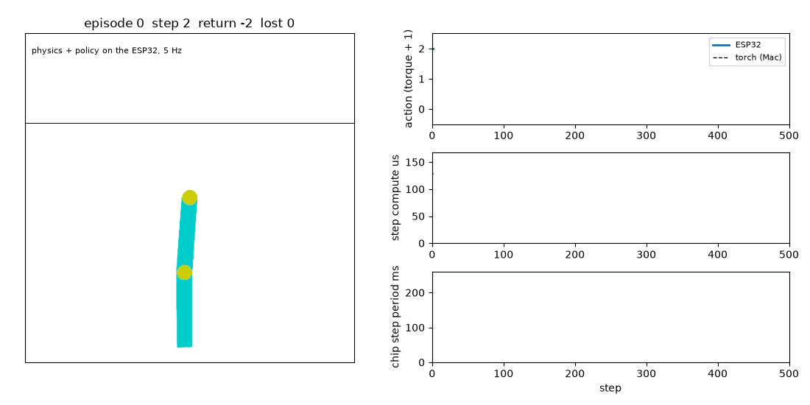
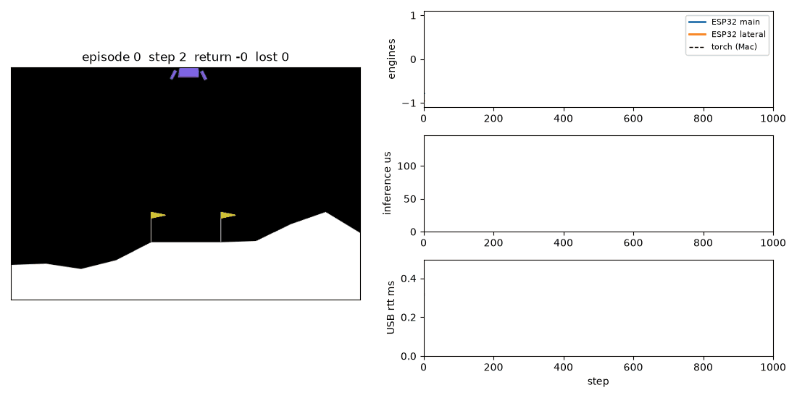
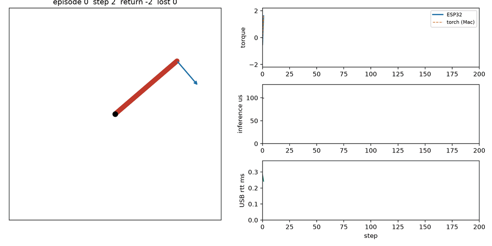
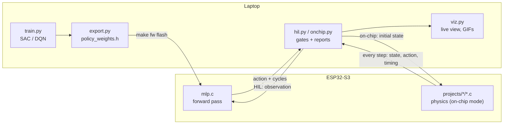

<div align="center">

# espRL

**Deep RL policies trained on a laptop, running as plain C on a ~$20 microcontroller board, verified against PyTorch on
real hardware.**

[](LICENSE)
[](https://www.python.org/)
[](https://pytorch.org/)
[](https://github.com/DLR-RM/stable-baselines3)
[](https://github.com/Farama-Foundation/Gymnasium)
<br>
[](https://github.com/espressif/esp-idf)
[-00979D?logo=arduino&logoColor=white)](https://docs.arduino.cc/hardware/nano-esp32/)
[](#results)
[](#results)
[](https://github.com/ALVAROI12/espRL/stargazers)


*Cart-pole swing-up. The physics and the neural network both run on the ESP32 at 50 Hz; the laptop only draws.*

</div>

## Why espRL

Most "RL on a microcontroller" demos stop at "it runs". espRL treats the chip as the thing under test:

- **No ML framework on the chip.** The policy is a 43-line C file (`mlp.c`): no TFLite Micro, no ESP-DL, no heap.
  The same file is compiled on the laptop for unit tests and on the ESP32 for the real thing.
- **Every policy is gated on the board.** `make hil` runs 10 episodes with every action coming from the chip and
  checks it against the PyTorch policy on the same observation. The gate is 1e-4; measured differences are 0 to
  3.2e-6.
- **Physics on the chip, in real time.** For the cart-pole and the acrobot the ESP32 also runs the physics, one step
  per env tick on FreeRTOS. A timing gate holds every step to within 1 ms of the target period; measured jitter is
  at most 3 µs.
- **Ports checked against the source.** Each C physics port is tested step by step against the Python environment
  it replaces (Gymnasium's own for the acrobot).
- **One command per step, reproducible.** `make train / fw / flash / hil / onchip / viz`, fixed seeds, and every
  number below comes from a JSON report the tools write.

## What it applies, and what it adds

| Applied (standard techniques) | Added here |
|---|---|
| Deep RL: SAC for continuous control, DQN for discrete (Stable-Baselines3) | Export of the trained network to a C header and a framework-free forward pass (tanh-scaled actions or argmax Q) |
| Hardware-in-the-loop testing, as used for flight and automotive controllers | Lockstep chip vs PyTorch comparison on every step, plus return/success gates per env |
| Real-time control on an RTOS (FreeRTOS on ESP-IDF) | Simulator and policy both on the MCU, streaming each step over USB, with a step-period gate |
| Physics simulation (Gymnasium, Box2D, own cart-pole) | float32 C ports of the physics, verified step by step against float64 Python |

## Projects

Each project lives in its own folder under [`projects/`](projects/) with its env code, C port, tests, results and
clips.

| | Project | Algorithm | Where the physics runs | Result on the board (10 episodes) |
|---|---|---|---|---|
|  | [**Cart-pole**](projects/cartpole/): balance and swing-up, own continuous env | SAC | Laptop (HIL) **and chip** (50 Hz) | 10/10 and 10/10 successes |
|  | [**Acrobot**](projects/acrobot/): Gymnasium `Acrobot-v1` | DQN | Laptop (HIL) **and chip** (5 Hz) | return -81.5 (solved: > -100) |
|  | [**Lunar lander**](projects/lunarlander/): Gymnasium `LunarLander-v3`, continuous | SAC | Laptop (Box2D, HIL) | return 269.1 (solved: > 200) |
|  | [**Pendulum**](projects/pendulum/): Gymnasium `Pendulum-v1` | SAC | Laptop (HIL) | return -131.6 (gate: > -250) |

## How it works



- **HIL mode** (`make hil`): the laptop steps the environment and sends each observation over USB; the chip answers
  with the action and its inference time in CPU cycles. Round trip: about 0.23 ms.
- **On-chip mode** (`make onchip`): the laptop sends only the initial state; the chip runs physics and policy in real
  time and streams every step. The laptop recomputes the PyTorch action on the chip's own observation and checks it.

## Results

Arduino Nano ESP32 (ESP32-S3 rev v0.2, 240 MHz), 10 episodes per run, 2026-11-16. Details in each project's README.

| Env | Mode | Score (gate) | Max chip vs torch | Inference / step | Timing |
|---|---|---|---|---|---|
| `pendulum` | HIL | -131.6 (> -250) | 1.85e-6 | 99 µs | rtt 0.22 ms |
| `cartpole_balance` | HIL / on-chip | 10/10 / 10/10 (>= 9/10) | 1.66e-6 / 1.85e-6 | 105 µs / 109 µs | period 20 ms ± 3 µs |
| `cartpole_swingup` | HIL / on-chip | 10/10 / 10/10 (>= 9/10) | 3.07e-6 / 3.23e-6 | 105 µs / 110 µs | period 20 ms ± 3 µs |
| `lunarlander` | HIL | 269.1 (> 200) | 1.83e-6 | 112 µs | rtt 0.25 ms |
| `acrobot` | HIL / on-chip | -81.5 / -81.5 (> -100) | 0 / 0 | 108 µs / 132 µs | period 200 ms ± 2 µs |

On-chip times include the physics step. Every run also requires 0 lost replies or dropped frames.

## Quick start

You need macOS or Linux, [uv](https://github.com/astral-sh/uv), Docker (Colima on macOS) and an Arduino Nano ESP32
on USB.

```bash
make setup                         # .venv: torch, SB3, gymnasium[box2d]
make test                          # host tests: C vs PyTorch, C physics vs Python, serial protocol
make train ENV=cartpole_swingup    # about 4 min; writes out/<env>.zip + firmware/main/policy_weights.h
colima start                       # Docker for ESP-IDF
make fw flash                      # build in the IDF container, flash from the host
make onchip ENV=cartpole_swingup   # gates on the board; report in out/onchip_<env>.json
make viz ENV=cartpole_swingup VIZ_ARGS=--onchip   # live view
```

`ENV=` is one of `pendulum` (default), `cartpole_balance`, `cartpole_swingup`, `lunarlander`, `acrobot`. The board
must run the header of the model being tested: `hil.py`, `onchip.py` and `viz.py` exit with code 2 when the header
was exported for another env. `PORT=` picks the serial port (default: first `/dev/cu.usbmodem*`).

## Repository layout

```
mlp.c, mlp.h        policy forward pass (host and chip)
export.py           SB3 policy -> C header (SAC actor or DQN Q-network)
train.py            env registry, training, gates
hil.py, onchip.py   board runs and reports
link.py             serial protocol
viz.py              live view and GIF recording
firmware/           ESP-IDF app: HIL server and on-chip episode loop
projects/<name>/    one folder per project: env code, C physics, tests, README, media/
```

Design notes: [`docs/superpowers/specs/`](docs/superpowers/specs/).

## Roadmap

- **On-device training**: learn on the ESP32 itself, starting with tabular Q-learning on toy-text envs.
- **Quantized inference**: int8 networks with ESP-DL, and a small CNN for image observations (`CarRacing-v3`).
- **More physics on the chip**: `MountainCarContinuous`, `CartPole-v1` through the new discrete path.

## Board notes

- The first flash over the Arduino bootloader fails once with "Device not configured": the board then
  re-enumerates as the ROM's USB-Serial/JTAG (303A:1001) and the next `make flash` works. Hold B1 to GND
  and reset if it never does. The Arduino sketch is gone after flashing; the Arduino IDE can restore it.
- `make flash` uses `--before usb-reset` and retries once: the default reset fails about every other time
  while the app runs.
- Only `main.c` and `mlp.c` are built `-O2`. With the whole image at `-O2`
  (`CONFIG_COMPILER_OPTIMIZATION_PERF`) the board answered one request per port open and then went silent;
  not traced further inside IDF.

## License

[GPL-3.0](LICENSE).
