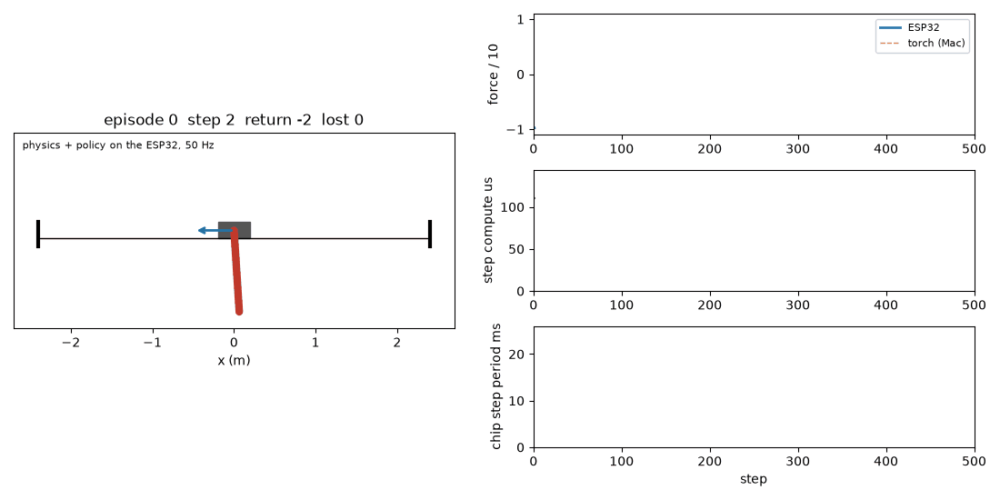

# espRL: RL on the ESP32

RL policies trained on the Mac (Stable-Baselines3) and run as plain C (`mlp.c`) on an Arduino Nano ESP32
(ESP32-S3). Hardware-in-the-loop (HIL): the Mac steps the env and gets every action from the board over USB.
On-chip: the board runs the physics too, in real time, and streams each step to the Mac.



## Projects

One folder per project under `projects/`, with its env code, tests, results and clips.

| Project | `ENV=` | Mode | Result on the board (10 episodes) |
|---|---|---|---|
| [Pendulum](projects/pendulum/) | `pendulum` | HIL | return -131.6 (gate > -250) |
| [Cart-pole](projects/cartpole/) | `cartpole_balance`, `cartpole_swingup` | HIL + on-chip | 10/10 and 10/10 (gate >= 9/10) |
| [Lunar lander](projects/lunarlander/) | `lunarlander` | HIL | return 269.1 (gate > 200) |

Every run also gates chip vs torch max action difference < 1e-4 and 0 lost replies.

## Pipeline (shared)

```
make setup               # .venv (torch, SB3, gymnasium[box2d])
make test                # host tests: C forward pass vs torch, serial protocol, project tests
make train [ENV=...]     # writes out/<env>.zip + firmware/main/policy_weights.h
colima start             # Docker for ESP-IDF
make fw                  # firmware/build-esp32s3
make flash [PORT=...]    # default PORT = first /dev/cu.usbmodem*
make hil [ENV=...]       # 10 episodes on the board; report in out/hil_<env>.json
make onchip ENV=...      # physics + policy on the chip (envs with a C port); out/onchip_<env>.json
make viz [ENV=...] [VIZ_ARGS="--onchip --save out/x.gif"]   # live view, or record
```

`make train ENV=x` and `make fw flash` go together: the board must run the header from the same model `make hil`
loads. `hil.py`/`onchip.py`/`viz.py` refuse to run (exit 2) when the header was exported for another env.
Design: `docs/superpowers/specs/2026-11-16-esp32-rl-hil-design.md`.

Root files: `mlp.c`/`mlp.h` (policy forward pass, host and chip), `export.py` (SB3 actor to C header), `link.py`
(serial protocol), `train.py` (env registry, training, gates), `hil.py`, `onchip.py`, `viz.py`, `firmware/`.

## Board notes

- The first flash over the Arduino bootloader fails once with "Device not configured": the board then
  re-enumerates as the ROM's USB-Serial/JTAG (303A:1001) and the next `make flash` works. Hold B1 to GND
  and reset if it never does. The Arduino sketch is gone after flashing; the Arduino IDE can restore it.
- `make flash` uses `--before usb-reset` and retries once: the default reset fails about every other time
  while the app runs.
- Only `main.c` and `mlp.c` are built `-O2`. With the whole image at `-O2`
  (`CONFIG_COMPILER_OPTIMIZATION_PERF`) the board answered one request per port open and then went silent;
  not traced further inside IDF.
