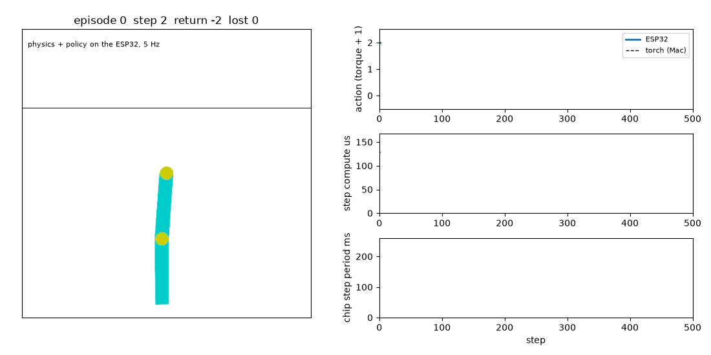

# Acrobot (Gymnasium `Acrobot-v1`, discrete; HIL and fully on the chip)

`ENV=acrobot`. A DQN policy (3 discrete torques) runs on the ESP32 as plain C (`argmax Q`), and so does the
Acrobot physics: `acrobot.c` is a float32 port of Gymnasium's `acrobot.py` (same RK4 step, angle wrap and velocity
bounds). Board: Arduino Nano ESP32 (ESP32-S3 rev v0.2, 240 MHz), 2026-11-16.

```
make train ENV=acrobot && make fw flash
make hil ENV=acrobot       # physics on the Mac, policy on the chip
make onchip ENV=acrobot    # physics and policy on the chip, 5 Hz (Acrobot-v1's dt = 0.2 s)
make viz ENV=acrobot VIZ_ARGS=--onchip
```

Files: `acrobot.c`/`acrobot.h` (physics for the chip), `acrobot.py` (observation and reward of a chip state, for
the Mac's checks), `test_acrobot_c.py` (C vs Gymnasium, step by step).

Gate: mean return > -100 (Acrobot-v1's `reward_threshold`), plus the shared ones.

| Metric | HIL | On chip | Gate |
|---|---|---|---|
| Steps / lost or incomplete | 825 / 0 | 825 / 0 | 0 |
| Mean return, chip (10 episodes) | -81.5 | -81.5 | > -100 |
| Max abs action difference chip vs torch | 0 (same argmax every step) | 0 | < 1e-4 |
| Inference (6-64-64-3 MLP + argmax) / compute per step (+ RK4 physics) | 108.4 us p50 | 132.0 us p50 | reported |
| USB round trip / chip step period | 0.23 ms p50 | 199998-200000 us | period 200000 +- 1000 us |

Policy: DQN, 100k steps, seed 0, net [64, 64], other settings from rl-baselines3-zoo (Acrobot-v1); under a minute on
the Mac.

C vs Gymnasium, one step from 20000 random states: median error 6e-7, p99 3e-5. The worst case, about 3e-3, comes
from float32 rounding near the velocity bound (|dth2| about 9 pi rad/s). The test pins those bounds.



Two episodes, physics and policy on the ESP32, real time (5 fps).
