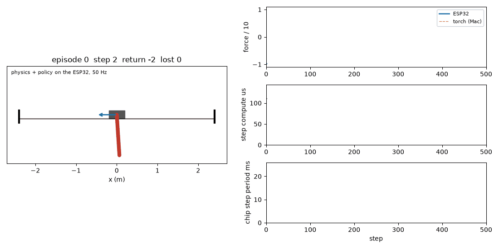
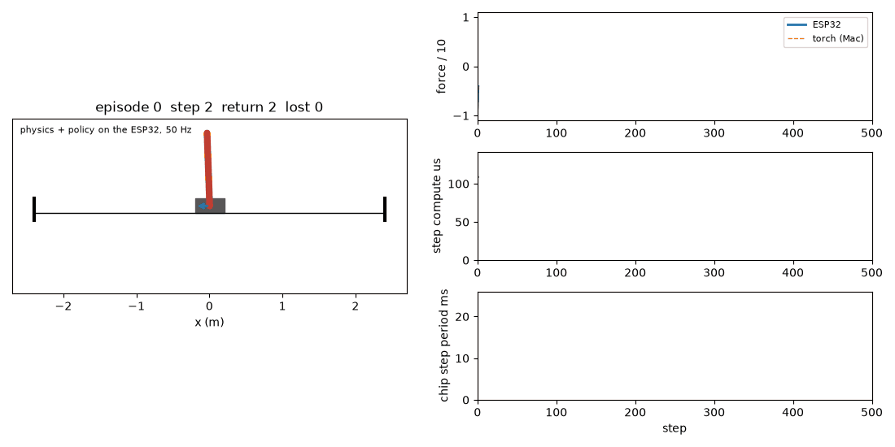

# Cart-pole (own continuous env: balance, swing-up)

`ENV=cartpole_balance` or `ENV=cartpole_swingup`. Design: `docs/superpowers/specs/2026-11-16-cartpole-design.md`.
Board: Arduino Nano ESP32 (ESP32-S3 rev v0.2, 240 MHz), 2026-11-16.

```
make train ENV=cartpole_swingup && make fw flash
make hil ENV=cartpole_swingup       # physics on the Mac, policy on the chip
make onchip ENV=cartpole_swingup    # physics and policy on the chip, 50 Hz
make viz ENV=cartpole_swingup VIZ_ARGS=--onchip
```

Files: `cartpole.py` (Gymnasium env, registered as `espRL/CartPole-v0`), `cartpole.c`/`cartpole.h` (float32 port
for the chip), `test_cartpole.py` (physics sanity), `test_cartpole_c.py` (C vs Python, step by step).

## HIL

Own env (`cartpole.py` here): frictionless cart-pole, 1 kg cart, 0.1 kg pole of 1 m, force +-10 N, track +-2.4 m,
50 Hz, 500 steps. Success = never leaves the track and cos th > 0.95 for each of the last 100 steps.

| Metric | Balance | Swing-up | Gate |
|---|---|---|---|
| Steps / lost replies | 5000 / 0 | 5000 / 0 | 0 lost |
| Successes, chip (10 episodes) | 10/10 | 10/10 | >= 9/10 |
| Mean return, chip / Python alone | 497.8 / 497.8 | 391.2 / 391.2 | reported |
| Max abs action difference chip vs torch | 1.66e-6 | 3.07e-6 | < 1e-4 |
| Inference, 5-64-64-1 float MLP | 105.3 us p50, 105.6 us p99 | 105.3 us p50, 111.1 us p99 | reported |
| USB round trip | 0.23 ms p50, 0.32 ms p99 | 0.23 ms p50, 0.32 ms p99 | reported |

Policies: SAC, seed 0, 60k steps (balance; 30k missed the gate) and 200k steps (swing-up), about 1 and 4 min
on the Mac. `make viz ENV=cartpole_swingup VIZ_ARGS="--save out/cartpole_swingup.gif"` records the swing-up.

## Physics on the chip too

`make onchip`: the ESP32 runs the cart-pole physics (`cartpole.c`, a float32 port of `cartpole.py`) and the policy,
one step every 20 ms (FreeRTOS `vTaskDelayUntil`), and streams every step over USB. The Mac only sends each
episode's initial state, then checks the stream: the torch actor on the chip's own observation (action diff),
successes on the chip's own trajectory, no dropped frames, and the step period. The chip computes in float32, so
on swing-up its trajectory is not compared with the Python float64 run; `test_cartpole_c.py` checks the C
physics step by step against `cartpole.py` instead. The pendulum stays HIL only.

| Metric | Balance | Swing-up | Gate |
|---|---|---|---|
| Steps / incomplete episodes | 5000 / 0 | 5000 / 0 | 0 incomplete |
| Successes, chip (10 episodes) | 10/10 | 10/10 | >= 9/10 |
| Max abs action difference chip vs torch | 1.85e-6 | 3.23e-6 | < 1e-4 |
| Step period | 19997-20001 us | 19997-20000 us | 20000 +- 1000 us |
| Compute per step (obs + policy + physics) | 108.6 us p50 | 110.4 us p50 | reported |

## Clips

Swing-up, physics and policy on the ESP32 (real time, 50 fps):



Balance, physics and policy on the ESP32:



HIL (physics on the Mac): [balance](media/balance_hil.gif), [swing-up](media/swingup_hil.gif) (20 fps).
