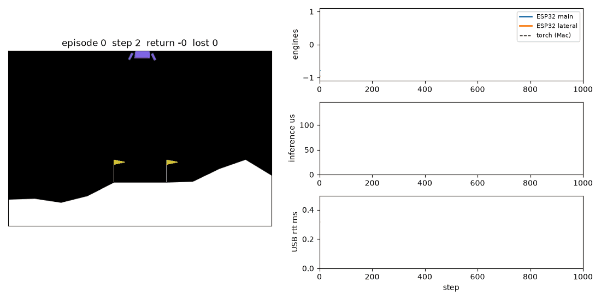

# Lunar lander (Gymnasium `LunarLander-v3`, continuous, HIL)

`ENV=lunarlander`. Policy on the ESP32, Box2D physics on the Mac. Board: Arduino Nano ESP32 (ESP32-S3 rev v0.2, 240 MHz), 2026-11-16.

```
make train ENV=lunarlander && make fw flash && make hil ENV=lunarlander
make viz ENV=lunarlander VIZ_ARGS="--save out/lunarlander.gif --episodes 2"
```

`LunarLander-v3` with `continuous=True`: 8 observations, 2 actions (main and lateral engine). Box2D physics on the
Mac. Gate: mean return > 200 (Gymnasium's "solved").

| Metric | Value | Gate |
|---|---|---|
| Steps / lost replies | 2443 / 0 | 0 lost |
| Mean return, chip / Python alone (10 episodes) | 269.1 / 269.1 | > 200 |
| Max abs action difference chip vs torch | 1.83e-6 | < 1e-4 |
| Inference, 8-64-64-2 float MLP | 112.4 us p50, 118.1 us p99 | reported |
| USB round trip | 0.25 ms p50, 0.34 ms p99 | reported |

Policy: SAC, 300k steps, seed 0, settings from rl-baselines3-zoo (lr 7.3e-4, batch 256, tau 0.01), about 12 min on
the Mac.


