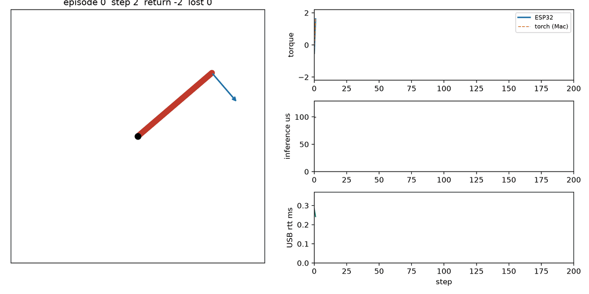

# Pendulum (Gymnasium `Pendulum-v1`, HIL)

Policy on the ESP32, physics on the Mac. `ENV=pendulum` (the default). Board: Arduino Nano ESP32 (ESP32-S3 rev v0.2, 240 MHz), 2026-11-16.

```
make train && make fw flash && make hil
make viz VIZ_ARGS="--save out/hil.gif"
```

| Metric | Value | Gate |
|---|---|---|
| Steps / lost replies | 2000 / 0 | 0 lost |
| Mean return, chip (10 episodes) | -131.6 | > -250 |
| Mean return, Python alone, same seeds | -131.6 | reported |
| Max abs action difference chip vs torch | 1.85e-6 | < 1e-4 |
| Inference, 3-64-64-1 float MLP | 99.0 us p50, 99.3 us p99 (23.8k cycles) | reported |
| USB round trip | 0.22 ms p50, 0.29 ms p99 | reported |

Policy: SAC, 20k steps, seed 0. Inference is with `mlp.c` at `-O2`; at the IDF default `-Og` it was 394 us.


